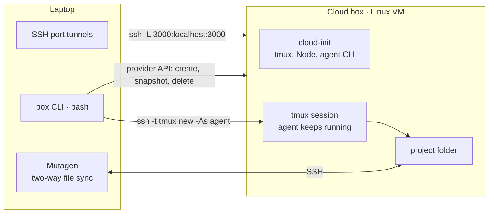

# Agent Box: a Persistent Cloud Box for AI Coding Agents

A design for one-command cloud boxes where an AI coding agent keeps working after you close your laptop. This repository holds the **specification, the roadmap, architecture diagrams and a clickable UI prototype**. The `box` command-line tool itself has not been built yet.


> **Status: nothing here has been run against a real cloud provider.** There is no `box` CLI, no `cloud-init.yaml` and no measured result. What exists is the design (`docs/`), two architecture diagrams (`diagrams/`) and a UI prototype with sample data (`ui/`). See [Status and limits](#status-and-limits).

## What it tries to prove

> A user runs one command and, in under 5 minutes, has a cloud Linux machine with an AI agent installed, their project folder synced and ports mirrored to localhost. They start an agent task, close the laptop, and the agent keeps working.

The first goal is a small, cheap test of that promise (one provider, one user, one box). The longer goal is a hosted service for developers who do not want to manage cloud infrastructure. The design was inferred from public descriptions of similar products, not from any product's internals.

## Idea



| Term | Meaning |
|---|---|
| **Box** | a persistent Linux VM owned by one user; files, tools and sessions survive between uses |
| **tmux** | a terminal session that lives on the box, which keeps the agent running when the laptop disconnects |
| **Mutagen** | two-way file sync between a local folder and the same folder on the box |
| **Sleep and wake** | snapshot the disk and delete the VM (only snapshot storage is billed), then recreate the VM from the snapshot |

### The planned `box` commands

`box init`, `box up [dir]`, `box agent`, `box ssh`, `box ports 3000 8000`, `box status`, `box sleep`, `box wake` and `box destroy`: a single bash script on top of the provider's CLI (Hetzner `hcloud` first, DigitalOcean as a fallback), with state in `~/.box/state.env` and timings in `~/.box/metrics.log`.

### Security design

SSH key login only, no password or root login, a firewall that allows inbound port 22 only (app ports are reached through SSH tunnels), secrets only in a mode-600 file on the box, and a warning that snapshots contain those secrets and must never be shared.

## What is in this repository

| Path | What it is |
|---|---|
| `docs/spec-mvp.md` | the full specification: scope, architecture, phases, the `box` CLI, a `cloud-init` starting point, the security checklist, 8 acceptance tests and the measurements to record |
| `docs/PLAN.md` | the roadmap in 7 stages, the budget for the 5 minutes, and the risks |
| `diagrams/` | two generated diagrams, `agent-box-service.html` (proposed service architecture) and `agent-box-deploy.html` (proposed deployment workflow). They are HTML files: download and open them in a browser. The `*.candidate.json` files are their sources |
| `ui/` | a clickable UI prototype with sample data (see below) |

## UI prototype

Vite 6, React 19, TypeScript, Tailwind 3, Framer Motion, TanStack Query and react-router 7. Pages: landing, login, box overview, agent session, ports, file sync, cost and a setup guide. **All data is sample data held in memory** (start, wake, sleep, destroy and port toggles change it, a reload resets it). It is not connected to any backend, and the prices shown are labelled as placeholders.

```bash
cd ui
npm install
npm run dev        # http://localhost:5173
npm run build      # type-check and production build
```

## Status and limits

- **Not built:** the `box` CLI, `cloud-init.yaml`, the sleep and wake logic, any control plane, billing or multi-user isolation. The service diagrams show a **proposed** design, and hosting, authentication, billing and isolation are open questions.
- **Not run:** nothing has been tested against Hetzner or any other provider, so the 5-minute target, the costs and the file-sync latency are unmeasured. The estimated spend for the first test (about 1 to 3 USD) is unverified.
- **UI:** it was built and type-checked as a prototype, and was not re-run for this repository. It only shows sample data.
- **Diagrams:** generated, and the layout was not visually reviewed.
- **Largest risk for a hosted version:** isolating one user's agent from another's when running other people's code.

## License

[MIT](LICENSE)
